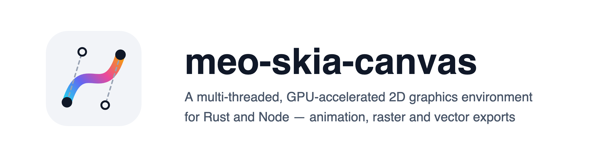
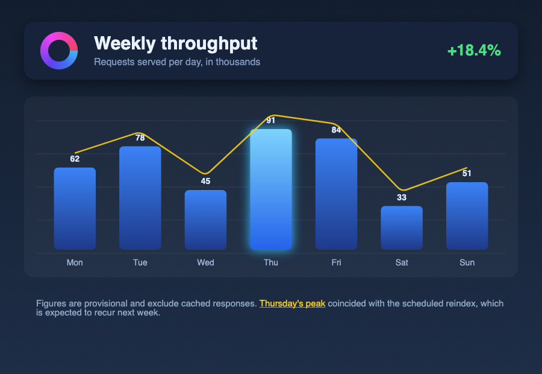
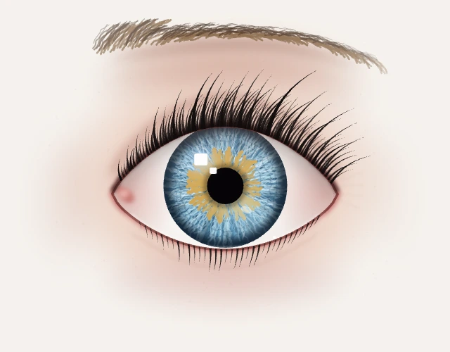

<picture>
  <source media="(prefers-color-scheme: dark)" srcset="https://raw.githubusercontent.com/l7aromeo/meo-skia-canvas/main/docs/assets/brand/hero-dark%402x.png">
  
</picture>

[](https://www.npmjs.com/package/meo-skia-canvas)
[](https://crates.io/crates/meo-skia-canvas)
[](https://docs.rs/meo-skia-canvas)
[](https://l7aromeo.github.io/meo-skia-canvas/)
[](https://github.com/l7aromeo/meo-skia-canvas/actions/workflows/ci.yml)
[](#license)

The HTML Canvas 2D [API](https://developer.mozilla.org/en-US/docs/Web/API/Canvas_API), off-screen
and on-screen, on Google's [Skia] engine, so output matches Chrome's
[`<canvas>`](https://html.spec.whatwg.org/multipage/canvas.html) closely, while doing a number of
things the browser's canvas cannot.

**One library, two surfaces.** The same source tree ships a Rust crate and a Node addon, the same
API in each language's spelling: `fillRect` is `fill_rect`, and `fillStyle` reads as
`fill_style()` and writes as `set_fill_style()`. One implementation sits under both.

> A fork of [samizdatco/skia-canvas], by way of [phyrondev/phyron-skia-canvas], and substantially
> diverged from both. The design is theirs; see [Acknowledgements](#acknowledgements).

## Contents

[Quick start](#quick-start) · [What it does](#what-it-does) · [Colour and precision](#colour-and-precision) · [Performance and memory](#performance-and-memory) · [Examples](#examples) · [Documentation](#documentation) · [Platform support](#platform-support) · [Why this fork exists](#why-this-fork-exists)

## Quick start

### Node.js

Requires Node 22 or newer.

```bash
npm install meo-skia-canvas
```

```js
import { Canvas } from "meo-skia-canvas";

let canvas = new Canvas(800, 600),
  ctx = canvas.getContext("2d");

ctx.fillStyle = "#1e293b";
ctx.fillRect(0, 0, 800, 600);

ctx.font = "600 72px Helvetica";
ctx.fillStyle = "#f8fafc";
ctx.fillText("Hello", 60, 140);

await canvas.toFile("out.png"); // or .pdf, .svg, .jpg, .webp
```

The binary arrives as a platform package, so nothing runs at install on the seven platforms
published. Elsewhere an install script fetches or builds one, which bun runs only for a package the
project lists in its own `trustedDependencies`: [docs/readme/npm.md](docs/readme/npm.md) has the
details.

### Rust

Requires Rust 1.90 or newer, and CMake 3.9 or newer for the AV1 codec the crate builds; on x86_64,
`yasm` or a NASM older than 3.0 as well.

```toml
[dependencies]
meo-skia-canvas = { version = "0.16", default-features = false, features = ["vulkan", "freetype"] }
```

```rust
use meo_skia_canvas::prelude::*;

let mut canvas = Canvas::new(800.0, 600.0);
{
    let ctx = canvas.context();
    ctx.set_fill_style_css("#1e293b")?;
    ctx.fill_rect(0.0, 0.0, 800.0, 600.0);
    ctx.set_font_css("600 72px Helvetica");
    ctx.set_fill_style_css("#f8fafc")?;
    ctx.fill_text("Hello", 60.0, 140.0, None);
}
canvas.to_file("out.png", &EncodeOptions::default())?;
```

The default feature set is empty; [docs/readme/crate.md](docs/readme/crate.md) lists the features
and the Skia the crate is built on, `skia-safe` 0.156.0, Skia M156.

## What it does

Everything a browser canvas does, and then:

- **Raster and vector export**: PNG, JPEG, WebP, GIF, APNG, TIFF, ICO, BMP, AVIF, PDF, SVG and raw
  pixels, a float canvas at sixteen bits a channel where the format holds it.
- **Animation**: pages are frames, written as WebP, GIF, APNG or AVIF, each frame only the rectangle
  it changed; an animation read back reports its own frames and delays.
- **An SVG says what the canvas drew**: what SVG cannot describe is embedded as pixels, not dropped.
- **Multi-page documents**: `newPage()`, written as one PDF, TIFF or ICO, or as a sequence.
- **A canvas drawn onto a canvas is replayed, not resampled.**
- **GUI windows** with a browser-like event framework, from Rust as well as Node.
- **Path geometry**: boolean operations, `simplify`, `round`, `trim`, `jitter`, `points`,
  `interpolate`, 3D projection, vector textures and dash markers.
- **The full CSS filter set**, plus CanvasKit's `ColorFilter`, `ImageFilter`, `MaskFilter`, `Shader`
  and `ColorMatrix`.
- **Exact blurs**: a `blur()` or `drop-shadow()` filter is the exact Gaussian blur of what it
  filters, where a browser approximates it.
- **Typography**: wrapped multi-line text, per-line metrics, variable-font axes, OpenType features,
  and `Paragraph` for rich text with mixed styles and hit-testing.
- **Threaded rendering and I/O** off the main thread.
- **Images from URLs in Rust**: `Image::from_url` and `ImageData::from_url` load over `http` and
  `https`, with Subresource Integrity checks, behind the crate's `fetch` feature.

## Colour and precision

A canvas composites in the space you name and exports in it: fifteen names across eight spaces,
sRGB, Display P3, Rec. 2020, HDR10 (PQ), HLG and linear variants, read back in any of them, with the
CSS Color 4 functions and `color-mix()`. A float `colorType` composites in float; an eight-bit
canvas stores a translucent colour's exact product, rounded once.
[docs/colour.md](docs/colour.md) has the spaces, the formats that carry them and what each
`colorType` costs.

## Performance and memory

A mixed vector scene takes 2.8 ms on the GPU against 4.6 on the CPU on an Apple M4 Pro; a float
canvas costs between 0.73× and 6.52× an eight-bit one depending on what is drawn.
[docs/performance.md](docs/performance.md) has drawing, encoding, decoding and memory, measured with
`just bench`, and how to read the figures.

## Examples

Five scripts in [`examples/node`](examples/node), each with a Rust twin in
[`examples/rust`](examples/rust). Three draw the gallery below, which `just examples` redraws from
them, so it cannot drift from what the library does; their twins draw the same pictures.





[`report-card.js`](examples/node/report-card.js) is a report generator's page;
[`feature-sheet.js`](examples/node/feature-sheet.js) a test card per feature area;
[`animated-eye.js`](examples/node/animated-eye.js) an eye that winks, 150 frames of spring physics
with no keyframes, written as AVIF, WebP and GIF.

## Documentation

| Reference                                                         | Built from                                     |
| ----------------------------------------------------------------- | ---------------------------------------------- |
| [**JavaScript API**](https://l7aromeo.github.io/meo-skia-canvas/) | The type declarations that ship in the package |
| [**docs.rs**](https://docs.rs/meo-skia-canvas)                    | The Rust crate's own doc comments              |

| Guide                                              | Covers                                                           |
| -------------------------------------------------- | ---------------------------------------------------------------- |
| [Getting started](docs/getting-started.md)         | Install and first render.                                        |
| [Node API](docs/node.md)                           | Platform notes and the JavaScript API.                           |
| [Rust crate](docs/rust.md)                         | The crate surface, and how it differs from the JavaScript one.   |
| [Drawing context](docs/api/context.md)             | Conic curves, textures, dash markers, projection, illustrated.   |
| [Path geometry](docs/api/path2d.md)                | Boolean operations, trim, jitter, interpolate, with pictures.    |
| [Colour and precision](docs/colour.md)             | Spaces, depths and what each format carries.                     |
| [Performance and memory](docs/performance.md)      | What each operation costs, and how to measure it.                |
| [Browser differences](docs/browser-differences.md) | Where output differs from Chrome on purpose, or because of Skia. |
| [Changelog](CHANGELOG.md)                          | Index; one file per release channel.                             |

## Platform support

Prebuilt binaries for Linux (x64/arm64, glibc and musl), macOS (arm64) and Windows (x64/arm64). The
Linux binaries are held to symbol ceilings, glibc 2.34 and `GLIBCXX` 3.4.25, and each build is
loaded and made to render inside AlmaLinux 8, glibc 2.28: RHEL 8 and 9, Ubuntu 20.04, Debian 11 and
Amazon Linux 2023 are supported. [docs/internals/packaging.md](docs/internals/packaging.md) has how they are held.

## Why this fork exists

**Two surfaces, one implementation.** A Rust crate and a Node addon from one source, the same calls
in each language's spelling. No public Rust signature hands you a `skia_safe`, `neon`, `ureq` or
`http` type, which `scripts/check-public-api.mjs` checks in CI.

**The binary arrives without running anything.** One npm package per target, chosen by
`os`/`cpu`/`libc`, rather than fetched by an install script that bun and `--ignore-scripts` block.

**The Linux floors are commitments, not descriptions.** Every Linux artifact is held to symbol
ceilings and then loaded inside the oldest platform claimed.

**It is built for processes that run for hours.** Every cache states what bounds it, what
invalidates an entry and what releases it, and rendering that stops hands its memory back.

**Nothing here is tuned by assertion.** Where a setting could go either way, the drawing decides
and the probe is measured; where one is pinned, the code says what pinning costs.

## Acknowledgements

Built on [`rust-skia`](https://github.com/rust-skia/rust-skia) (`skia-safe` + `skia-bindings`).

Forked from [samizdatco/skia-canvas], by way of [phyrondev/phyron-skia-canvas]. The architecture
here is theirs -- the Skia binding, the canvas state model, the font stack -- and so is the
groundwork everything since has been built on; thanks to the contributors of
[both](https://github.com/samizdatco/skia-canvas/graphs/contributors)
[projects](https://github.com/phyrondev/phyron-skia-canvas/graphs/contributors).

## License

MIT. See [`LICENSE`](LICENSE).

© 2020–2026 Samizdat Drafting Co., Phyron AB and contributors.
© 2026 L A Romeo, for changes made in this fork.

[Skia]: https://skia.org
[samizdatco/skia-canvas]: https://github.com/samizdatco/skia-canvas
[phyrondev/phyron-skia-canvas]: https://github.com/phyrondev/phyron-skia-canvas
