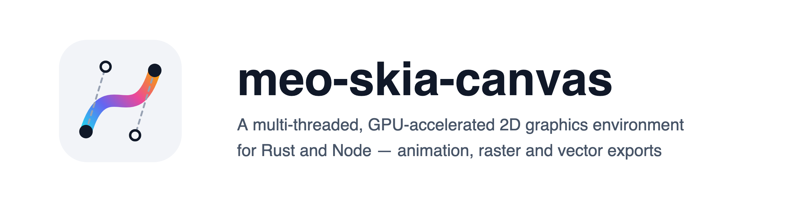

<picture>
  <source media="(prefers-color-scheme: dark)" srcset="https://raw.githubusercontent.com/l7aromeo/meo-skia-canvas/main/docs/assets/brand/hero-dark%402x.png">
  
</picture>

[](https://www.npmjs.com/package/meo-skia-canvas)
[](https://crates.io/crates/meo-skia-canvas)
[](https://docs.rs/meo-skia-canvas)
[](https://l7aromeo.github.io/meo-skia-canvas/)
[](https://github.com/l7aromeo/meo-skia-canvas/actions/workflows/ci.yml)
[](#license)

The HTML Canvas 2D [API](https://developer.mozilla.org/en-US/docs/Web/API/Canvas_API), off-screen
and on-screen, on Google's [Skia] engine, so output matches Chrome's
[`<canvas>`](https://html.spec.whatwg.org/multipage/canvas.html) closely, while doing a number of
things the browser's canvas cannot.

**One library, two surfaces.** The same source tree ships a Rust crate and a Node addon, the same
API in each language's spelling: `fillRect` is `fill_rect`, and `fillStyle` reads as
`fill_style()` and writes as `set_fill_style()`. One implementation sits under both.

## Install

Requires Rust 1.90 or newer, and CMake 3.9 or newer: the AV1 codec the crate compiles from source
(libaom 3.11, through `libaom-sys`) is configured and built with it. On x86_64 that build also
needs `yasm`, or a NASM older than 3.0, because libaom takes `yasm` first and rejects NASM 3.x at
configure time.

```toml
[dependencies]
meo-skia-canvas = { version = "0.17", default-features = false, features = ["vulkan"] }
```

On Linux, set the `SKIA_BINARIES_URL` below even without the patches. The crate embeds FreeType
there, rust-skia hosts no prebuilt Skia built with it, and without the URL skia-bindings compiles
Skia from source over the network -- about 13 minutes on a GitHub-hosted runner.

To draw what the npm package draws, with this repository's patched Skia rather than crates.io's, add
`patched-skia` and name its archives:

```toml
# Cargo.toml
[dependencies]
meo-skia-canvas = { version = "0.17", default-features = false, features = ["vulkan", "patched-skia"] }
```

```toml
# .cargo/config.toml
[env]
SKIA_BINARIES_URL = "https://github.com/l7aromeo/meo-skia-canvas/releases/download/skia-binaries-0.156.0-3f566dd7198c/skia-binaries-{key}.tar.gz"
```

```rust,no_run
use meo_skia_canvas::prelude::*;

fn main() -> Result<(), Box<dyn std::error::Error>> {
    let mut canvas = Canvas::new(800.0, 600.0);
    {
        let ctx = canvas.context();
        ctx.set_fill_style_css("#1e293b")?;
        ctx.fill_rect(0.0, 0.0, 800.0, 600.0);

        let mut font = Font::new("Helvetica", 72.0);
        font.weight = 600;
        ctx.set_font(&font);
        ctx.set_fill_style_css("#f8fafc")?;
        ctx.fill_text("Hello", 60.0, 140.0, Some(680.0));
    }
    canvas.to_file("out.png", &EncodeOptions::default())?;
    Ok(())
}
```

The crate is a consumer API, not a byproduct of building the addon. Every public type outside
windowing is reachable as `meo_skia_canvas::Thing` -- the modules group them by subject for
reading, but one drawing reaches across several and nothing should require knowing which. The
windowing types live under `meo_skia_canvas::gui`, behind the `window` feature, and the `prelude`
globs the root's set and adds the windowing types a program uses, such as `App`, `Window` and
`UiEvent`. The Node binding stays behind an internal module, and no public signature hands you a
type from Skia, Neon or the HTTP stack, windowing included: `scripts/check-public-api.mjs` names
those crates, reads rustdoc's JSON in CI and fails on a leak, with no module exempted, so the
promise is checked rather than kept by hand.

Reference: [`docs/rust.md`](https://github.com/l7aromeo/meo-skia-canvas/blob/main/docs/rust.md). Runnable code:
[`examples/rust`](https://github.com/l7aromeo/meo-skia-canvas/tree/main/examples/rust) -- six programs, five of them drawing the same scene as their
[`examples/node`](https://github.com/l7aromeo/meo-skia-canvas/tree/main/examples/node) counterpart, so anything one surface can draw the other can too.

## Cargo features

| Feature        | Notes                                                                                            |
| -------------- | ------------------------------------------------------------------------------------------------ |
| `vulkan`       | Vulkan backend (Linux / Windows).                                                                |
| `metal`        | Metal backend (macOS).                                                                           |
| `window`       | `winit`-backed event loop.                                                                       |
| `freetype`     | Does nothing. Linux builds always embed FreeType and its WOFF2 support.                          |
| `fetch`        | `Image::from_url` and `ImageData::from_url`, over `http` and `https`.                            |
| `patched-skia` | This repository's patched Skia, from the archives `SKIA_BINARIES_URL` names; refused without it. |
| `node-addon`   | Register the `#[neon::main]` Node addon entry point. Pure-Rust consumers leave this off.         |

The default feature set is empty; opt in to the backend you need.

## Skia version

Built on `skia-safe` 0.156.0, which pins Skia
[M156](https://skia.googlesource.com/skia/+/refs/heads/chrome/m156/RELEASE_NOTES.md) -- the branch
Chrome 156 builds from, which is what "output matches Chrome's canvas" is measured against.

The Skia revision comes from `skia-safe`; bumping it is a minor-version event for this crate, and
the [crate changelog](https://github.com/l7aromeo/meo-skia-canvas/blob/main/CHANGELOG-crate.md) records which pairing each release shipped.

## What it does

Everything a browser canvas does, and then:

- **Raster and vector export**: PNG, JPEG, WebP, GIF, APNG, TIFF, ICO, BMP, AVIF, PDF, SVG and raw
  pixels, a float canvas at sixteen bits a channel where the format holds it.
- **Animation**: pages are frames, written as WebP, GIF, APNG or AVIF, each frame only the rectangle
  it changed; an animation read back reports its own frames and delays.
- **An SVG says what the canvas drew**: what SVG cannot describe is embedded as pixels, not dropped.
- **Multi-page documents**: `Canvas::new_page`, written as one PDF, TIFF or ICO, or as a sequence.
- **A canvas drawn onto a canvas is replayed, not resampled.**
- **GUI windows** with a browser-like event framework, behind the `window` feature.
- **Path geometry**: boolean operations, `Path2D::simplify`, `round`, `trim`, `jitter`, `points`
  and `interpolate`, 3D projection through `create_projection`, vector textures and dash markers.
- **The full CSS filter set**, plus CanvasKit's `ColorFilter`, `ImageFilter`, `MaskFilter`, `Shader`
  and `ColorMatrix`.
- **Exact blurs**: a `blur()` or `drop-shadow()` filter is the exact Gaussian blur of what it
  filters, where a browser approximates it.
- **Typography**: wrapped multi-line text, per-line metrics, variable-font axes, OpenType features,
  and `Paragraph` for rich text with mixed styles and hit-testing.
- **Threaded rendering and I/O** off the main thread.
- **Images from URLs**: `Image::from_url` and `ImageData::from_url` load over `http` and `https`,
  with Subresource Integrity checks, behind the `fetch` feature.

## Colour and precision

A canvas composites in the `PixelColorSpace` you give it and exports in it: eight spaces, sRGB,
Display P3, Rec. 2020, HDR10 (PQ), HLG and the linear variants, read back in any of them, with the
CSS Color 4 functions and `color-mix()`. A canvas at `PixelDepth::F16` or `F32` composites in
float; an eight-bit canvas rounds a translucent colour's product with its alpha once, and takes
the backdrop's share at an eight-bit alpha.
[docs/colour.md](https://github.com/l7aromeo/meo-skia-canvas/blob/main/docs/colour.md) has the spaces, the formats that carry them and what each
depth costs.

## Performance and memory

A mixed vector scene takes 2.8 ms on the GPU against 4.6 on the CPU on an Apple M4 Pro; a float
canvas costs between 0.73× and 6.52× an eight-bit one depending on what is drawn.
[docs/performance.md](https://github.com/l7aromeo/meo-skia-canvas/blob/main/docs/performance.md) has drawing, encoding, decoding and memory, measured with
`just bench`, and how to read the figures.

## Documentation

- [**docs.rs**](https://docs.rs/meo-skia-canvas), from the crate's own doc comments.
- [The Rust crate guide](https://github.com/l7aromeo/meo-skia-canvas/blob/main/docs/rust.md): the surface, and how it differs from the JavaScript one.
- [Where output differs from Chrome](https://github.com/l7aromeo/meo-skia-canvas/blob/main/docs/browser-differences.md), and the
  [changelog](https://github.com/l7aromeo/meo-skia-canvas/blob/main/CHANGELOG-crate.md). The same library is a Node addon,
  [`meo-skia-canvas` on npm](https://www.npmjs.com/package/meo-skia-canvas).

## License

MIT. See [`LICENSE`](https://github.com/l7aromeo/meo-skia-canvas/blob/main/LICENSE). A fork of [samizdatco/skia-canvas], by way of
[phyrondev/phyron-skia-canvas]; the architecture is theirs.

[Skia]: https://skia.org
[samizdatco/skia-canvas]: https://github.com/samizdatco/skia-canvas
[phyrondev/phyron-skia-canvas]: https://github.com/phyrondev/phyron-skia-canvas
