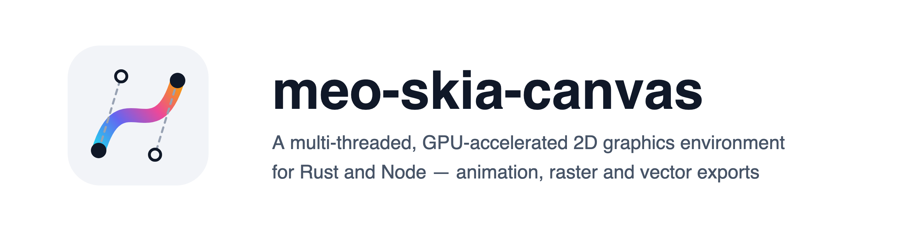

<picture>
  <source media="(prefers-color-scheme: dark)" srcset="https://raw.githubusercontent.com/l7aromeo/meo-skia-canvas/main/docs/assets/brand/hero-dark%402x.png">
  
</picture>

[](https://www.npmjs.com/package/meo-skia-canvas)
[](https://crates.io/crates/meo-skia-canvas)
[](https://docs.rs/meo-skia-canvas)
[](https://l7aromeo.github.io/meo-skia-canvas/)
[](https://github.com/l7aromeo/meo-skia-canvas/actions/workflows/ci.yml)
[](#license)

The HTML Canvas 2D [API](https://developer.mozilla.org/en-US/docs/Web/API/Canvas_API), off-screen
and on-screen, on Google's [Skia] engine, so output matches Chrome's
[`<canvas>`](https://html.spec.whatwg.org/multipage/canvas.html) closely, while doing a number of
things the browser's canvas cannot.

**One library, two surfaces.** The same source tree ships a Rust crate and a Node addon, the same
API in each language's spelling: `fillRect` is `fill_rect`, and `fillStyle` reads as
`fill_style()` and writes as `set_fill_style()`. One implementation sits under both.

## Install

Requires Node 22 or newer.

```bash
npm install meo-skia-canvas
```

```js
import { Canvas } from "meo-skia-canvas";

let canvas = new Canvas(800, 600),
  ctx = canvas.getContext("2d");

ctx.fillStyle = "#1e293b";
ctx.fillRect(0, 0, 800, 600);

ctx.font = "600 72px Helvetica";
ctx.fillStyle = "#f8fafc";
ctx.fillText("Hello", 60, 140);

await canvas.toFile("out.png"); // or .pdf, .svg, .jpg, .webp
```

No `trustedDependencies` entry and no `--ignore-scripts` exception is needed: the binary arrives as
one of seven platform packages, `darwin-arm64`, `linux-{x64,arm64}-{glibc,musl}` and
`win32-{x64,arm64}`, chosen by `os`, `cpu` and `libc`.

**Unless your platform has none.** Anything else, an Intel Mac among them, has no platform package
and no prebuilt binary on the release, so an install from npm fails. Build the addon from a clone of
the repository instead, as
[Compiling from Source](https://github.com/l7aromeo/meo-skia-canvas/blob/main/docs/node.md#compiling-from-source)
describes.

On a platform that has one, an install that leaves optional dependencies out (`--omit=optional`)
falls back to the `install` script in `package.json`, which downloads that platform's binary from
the release. npm runs that script. bun does not, unless the consuming project lists the package in
its own `trustedDependencies` -- a list that is not inherited from a dependency:

```json
{ "trustedDependencies": ["meo-skia-canvas"] }
```

or `bun pm trust meo-skia-canvas` after the fact. Without it bun installs the package, skips the
script and leaves no binary, and the failure surfaces at the first `require`; `bun pm untrusted`
lists what was blocked.

## What it does

Everything a browser canvas does, and then:

- **Raster and vector export**: PNG, JPEG, WebP, GIF, APNG, TIFF, ICO, BMP, AVIF, PDF, SVG and raw
  pixels, a float canvas at sixteen bits a channel where the format holds it.
- **Animation**: pages are frames, written as WebP, GIF, APNG or AVIF, each frame only the rectangle
  it changed; an animation read back reports its own frames and delays.
- **An SVG says what the canvas drew**: what SVG cannot describe is embedded as pixels, not dropped.
- **Multi-page documents**: `newPage()`, written as one PDF, TIFF or ICO, or as a sequence.
- **A canvas drawn onto a canvas is replayed, not resampled.**
- **GUI windows** with a browser-like event framework, from Rust as well as Node.
- **Path geometry**: boolean operations, `simplify`, `round`, `trim`, `jitter`, `points`,
  `interpolate`, 3D projection, vector textures and dash markers.
- **The full CSS filter set**, plus CanvasKit's `ColorFilter`, `ImageFilter`, `MaskFilter`, `Shader`
  and `ColorMatrix`.
- **Exact blurs**: a `blur()` or `drop-shadow()` filter is the exact Gaussian blur of what it
  filters, where a browser approximates it.
- **Typography**: wrapped multi-line text, per-line metrics, variable-font axes, OpenType features,
  and `Paragraph` for rich text with mixed styles and hit-testing.
- **Threaded rendering and I/O** off the main thread.

## Colour and precision

A canvas composites in the space you name and exports in it: fifteen names across eight spaces,
sRGB, Display P3, Rec. 2020, HDR10 (PQ), HLG and linear variants, read back in any of them, with the
CSS Color 4 functions and `color-mix()`. A float `colorType` composites in float; an eight-bit
canvas stores a translucent colour's exact product, rounded once.
[docs/colour.md](https://github.com/l7aromeo/meo-skia-canvas/blob/main/docs/colour.md) has the spaces, the formats that carry them and what each
`colorType` costs.

## Performance and memory

A mixed vector scene takes 2.8 ms on the GPU against 4.6 on the CPU on an Apple M4 Pro; a float
canvas costs between 0.73× and 6.52× an eight-bit one depending on what is drawn.
[docs/performance.md](https://github.com/l7aromeo/meo-skia-canvas/blob/main/docs/performance.md) has drawing, encoding, decoding and memory, measured with
`just bench`, and how to read the figures.

## Documentation

- [**JavaScript API reference**](https://l7aromeo.github.io/meo-skia-canvas/), built from the type
  declarations this package ships, one copy per release.
- [Getting started](https://github.com/l7aromeo/meo-skia-canvas/blob/main/docs/getting-started.md), the [Node API notes](https://github.com/l7aromeo/meo-skia-canvas/blob/main/docs/node.md), the illustrated
  [drawing context](https://github.com/l7aromeo/meo-skia-canvas/blob/main/docs/api/context.md) and [path geometry](https://github.com/l7aromeo/meo-skia-canvas/blob/main/docs/api/path2d.md) guides, and
  [where output differs from Chrome](https://github.com/l7aromeo/meo-skia-canvas/blob/main/docs/browser-differences.md).
- [Changelog](https://github.com/l7aromeo/meo-skia-canvas/blob/main/CHANGELOG-npm.md). The same library is a Rust crate,
  [`meo-skia-canvas` on crates.io](https://crates.io/crates/meo-skia-canvas).

## Platform support

Prebuilt binaries for Linux (x64/arm64, glibc and musl), macOS (arm64) and Windows (x64/arm64). The
Linux binaries are held to symbol ceilings, glibc 2.28 and `GLIBCXX` 3.4.25, and each build is
loaded and made to render inside AlmaLinux 8, glibc 2.28: RHEL 8 and 9, Ubuntu 20.04, Debian 11 and
Amazon Linux 2023 are supported. [docs/internals/packaging.md](https://github.com/l7aromeo/meo-skia-canvas/blob/main/docs/internals/packaging.md) has how they are held.

## License

MIT. See [`LICENSE`](https://github.com/l7aromeo/meo-skia-canvas/blob/main/LICENSE). A fork of [samizdatco/skia-canvas], by way of
[phyrondev/phyron-skia-canvas]; the architecture is theirs.

[Skia]: https://skia.org
[samizdatco/skia-canvas]: https://github.com/samizdatco/skia-canvas
[phyrondev/phyron-skia-canvas]: https://github.com/phyrondev/phyron-skia-canvas
